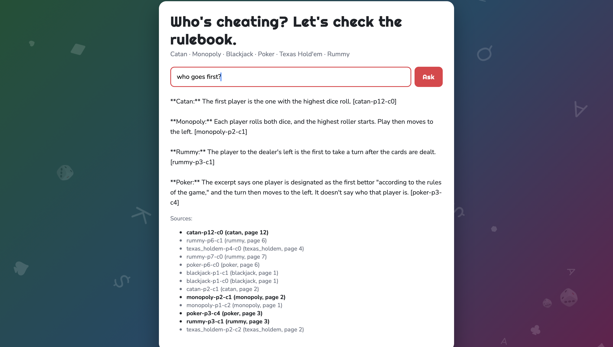

# Rulebook RAG

Ask a question about board and card game rules and get an answer grounded in the official rulebooks, with a citation for every claim. The system says so when the rules don't cover something, and it corrects popular house rules instead of repeating them.

Covers six games: CATAN, Monopoly, Blackjack, Poker, Texas Hold'em, and Rummy.



## What it does well

- **Cites its sources.** Every claim ends with the id of the rulebook excerpt it came from, e.g. `[monopoly-p2-c5]`. The UI highlights which retrieved excerpts were actually cited.
- **Refuses honestly.** Questions the rules don't answer ("What's the penalty for flipping the Catan board?") get "The provided rules don't cover this." instead of an invented rule. 6/6 on the unanswerable questions in every run.
- **Corrects myths.** "Do you collect money on Free Parking?" gets the official answer (no), not the popular house rule. 6/6 on the myth-buster questions.
- **Handles questions that don't name a game.** "Who goes first?" is answered separately for each game whose rules cover it.

## Results

Headline: **XX/41 answers correct, averaged over three runs of the final system (v8–v10).** Run-to-run variation is about ±1–2 questions, so changes smaller than that are not treated as real.

### Retrieval (does the right chunk come back?)

| Version | Change | R@1 | R@3 | R@5 | Notes |
|---|---|---|---|---|---|
| v1 | Dense baseline (all-MiniLM-L6-v2, 800-char chunks) | 0.66 | 0.89 | 0.89 | All misses ranked 6–10; R@10 = 1.00 |
| v2 | + Cross-encoder reranker on top 10 | 0.74 | 0.97 | 1.00 | Fixed all 4 v1 misses, no regressions |

### End-to-end answers (41 questions, LLM-judged)

| Version | Change | Score | Notes |
|---|---|---|---|
| v3 | Generation: Claude Haiku, prompt v2, k=3 | 27/41 | myth 6/6, unanswerable 6/6, multi-hop 2/7 |
| v4 | k=3 → k=5 | 31/41 | multi-hop 2/7 → 5/7 |
| v5 | Per-game routed retrieval + prompt v3 | 31/41 | disambiguation 4/9 → 8/9, but multi-hop 5/7 → 2/7 |
| v6 | Global top-5 + missing games | 32/41 | disambiguation 7/9, multi-hop 3/7 |
| v7 | k+1 for single-game questions | 32/41 | multi-hop 5/7 |
| v8 | No-game path searches every game, dedup by id | 35/41 | disambiguation 8/9, myth 6/6, unanswerable 6/6 |
| v9 | Same as v8, run as a script | 36/41 | |
| v10 | Same as v8, third run | 36/41 | |

Each version changes one thing, and every result is saved in `eval/results_<version>.csv` with the answer, the retrieved chunks, and the judge's reason.

## How it works

```
PDFs ─► ingest.py ─► chunk.py ─► retrieve.py ─────────────► generate.py ─► api.py ─► web UI
        extract +    800-char    route by game ─► dense      Claude Haiku,
        clean text   chunks      search ─► rerank            cite every claim
```

1. **Ingest** (`ingest.py`): extract text from each PDF as position-sorted blocks, then clean it (normalize characters, fix Monopoly's currency symbol, remove copyright and printer junk, join broken lines).
2. **Chunk** (`chunk.py`): group consecutive blocks into chunks of about 800 characters without splitting a paragraph. 113 chunks across six games, each tagged with its game and page.
3. **Retrieve** (`retrieve.py`): detect which game the question names, embed it, take the nearest chunks, and rerank them with a cross-encoder. Questions that name no game also get the best chunks from every other game, so one game can't crowd the rest out.
4. **Generate** (`generate.py`): send the question and the excerpts, each labeled with its id and game, to Claude with rules to answer only from the excerpts, cite every claim, and refuse when the excerpts don't contain the answer.
5. **Evaluate** (`eval.py`): run all 41 questions, have a second model call grade each answer against the expected one (PASS, FAIL, or ERROR), and save everything to a CSV.

## Design decisions

- **Position-sorted blocks for extraction.** Default PDF text order was jumbled on Catan's pages, and sorting line by line pushed side boxes into the middle of sentences. Sorting whole blocks kept paragraphs intact and in reading order.
- **800-character chunks.** Measured first: the median block was 26 characters and the 90th percentile 262, so single blocks were too small to stand alone. Grouping blocks up to about 800 characters holds a heading plus its rule.
- **A reranker on top of dense search.** All four v1 misses ranked 6–10 and recall@10 was 1.00, so the right chunk was always close. A cross-encoder reranking the top 10 raised recall@5 from 0.89 to 1.00.
- **Per-game retrieval for questions without a game.** A single ranking let one game take every slot. Searching each game separately raised disambiguation from 4/9 to 8/9.
- **An ERROR verdict in the judge.** An early judge treated "no verdict" as FAIL and reported 0/41 when the judge itself had broken. A separate ERROR state shows when the measuring tool fails, not the system.
- **Eval questions written before building.** Including myth-busters (popular house rules the rulebook contradicts) and unanswerable questions, which are the only way to detect answers from the model's memory.

## What still fails, and why

| Questions | Cause |
|---|---|
| 3 table/figure questions | The answer is in an image (Catan's building costs, Monopoly's house icons), so it never appears in the extracted text. Predicted before building; would need image captions or a vision model. |
| 2 multi-hop questions | Fail in every run with the same retrieved chunks, so the cause is in generation. Not yet investigated. |

Other known limitations:

- **Keyword game detection** can't tell a game from a card with the same name: "What does the Monopoly card do?" is routed to the Monopoly game, not Catan's Monopoly card.
- **Extraction loses some symbols:** Rummy's suit symbols are images on the source page, and some Hold'em dollar amounts like "$15/$30" are garbled.
- **The model doesn't always follow every instruction**, e.g. sometimes adding a section for a game whose excerpts don't answer the question.
- **The judge is a model too.** It agreed with hand grading on all 12 faithfulness questions, but it can still be wrong on others.
- **41 questions is a small eval**, so scores move by ±1–2 between identical runs.

## Run it yourself

Requires Python 3.10+ and an Anthropic API key.

```bash
python3.12 -m venv .venv
source .venv/bin/activate
pip install -r requirements.txt
echo "ANTHROPIC_API_KEY=your-key-here" > .env
```

Download the six rulebooks (see Sources) into `data/raw/` with the file names shown, then build the index and start the app:

```bash
python src/rulebook_rag/ingest.py
python src/rulebook_rag/chunk.py
PYTHONPATH=src uvicorn rulebook_rag.api:app --reload
```

Open http://127.0.0.1:8000. The API docs are at http://127.0.0.1:8000/docs.

To run the evaluation (about 2 minutes, a few cents of API usage):

```bash
PYTHONPATH=src python -m rulebook_rag.eval <run-name>
```

## Project layout

```
src/rulebook_rag/   pipeline: ingest, chunk, retrieve, generate, eval, api, static/index.html
eval/               questions.csv (41 questions) and results for every version
notebooks/          exploration behind each design decision
data/               raw PDFs and processed text (not committed)
```

## Sources

The rulebooks are not included in this repo (copyright belongs to the publishers). Download them from the links below into `data/raw/` using the file names shown.

| Game | File | Source | Type | Accessed |
|---|---|---|---|---|
| CATAN | `catan.pdf` | [CATAN – The Game Rulebook (PDF)](https://www.catan.com/sites/default/files/2025-03/CN3081%20CATAN–The%20Game%20Rulebook%20secure%20%281%29.pdf), linked from [catan.com game rules](https://www.catan.com/understand-catan/game-rules) | Official PDF (6th ed., v6.250401) | 2026-10-13 |
| Monopoly | `monopoly.pdf` | [Hasbro C1009 instructions (PDF)](https://instructions.hasbro.com/api/download/C1009_en-us_monopoly-board-game-for-ages-8-for-2-6-players-includes-8-tokens-tokens-may-vary.pdf), from [Hasbro instructions page](https://instructions.hasbro.com/en-us/instruction/monopoly-board-game-for-ages-8-for-2-6-players-includes-8-tokens-tokens-may-vary) | Official PDF, **UK edition** board and wording | 2026-10-13 |
| Blackjack | `blackjack.pdf` | [Bicycle Cards: Blackjack](https://bicyclecards.com/how-to-play/blackjack) | Web page saved as PDF | 2026-10-13 |
| Poker | `poker.pdf` | [Bicycle Cards: Basics of Poker](https://bicyclecards.com/how-to-play/basics-of-poker) | Web page saved as PDF | 2026-10-13 |
| Texas Hold'em | `texas_holdem.pdf` | [Bicycle Cards: Texas Hold'em](https://bicyclecards.com/how-to-play/texas-holdem-poker) | Web page saved as PDF | 2026-10-13 |
| Rummy | `rummy.pdf` | [Rummy Basics](https://www.rummyrulebook.com/pages/rummy-basics/) + [Standard Rummy](https://www.rummyrulebook.com/pages/standard-rummy/) | Manual copy of both pages into Google Docs, exported as PDF | 2026-10-13 |

Web pages can change. The eval set in `eval/questions.csv` was written against the versions accessed on the dates above.


  **Live demo:** https://rulebook-rag-yasasvi.fly.dev (first load may take ~30 seconds while the server wakes up)